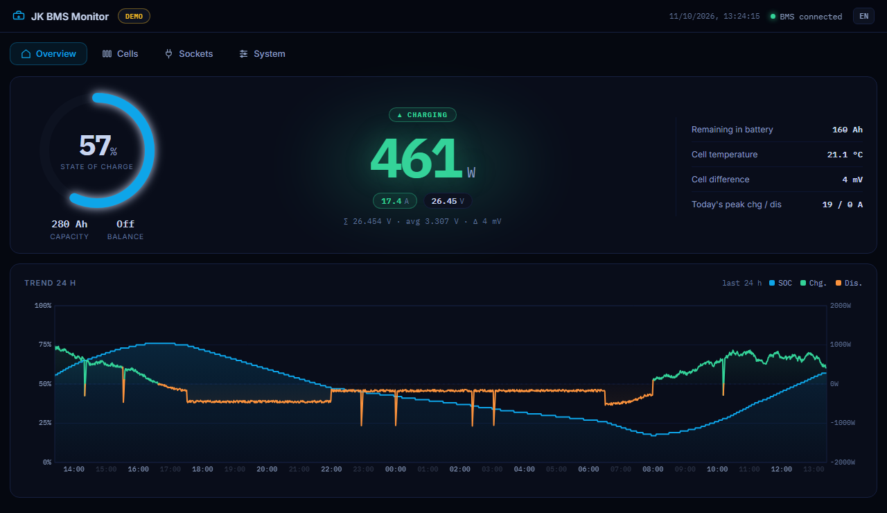
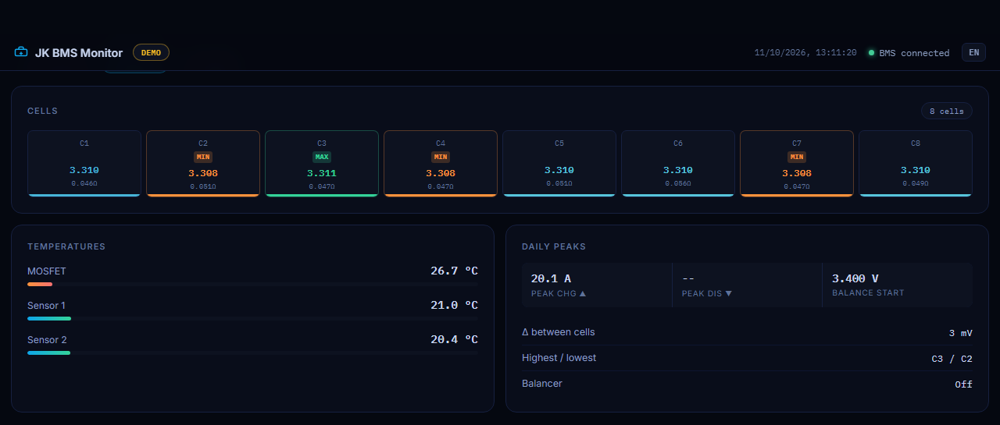
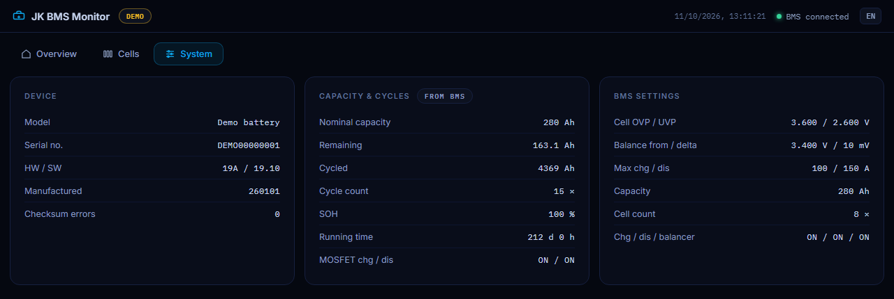
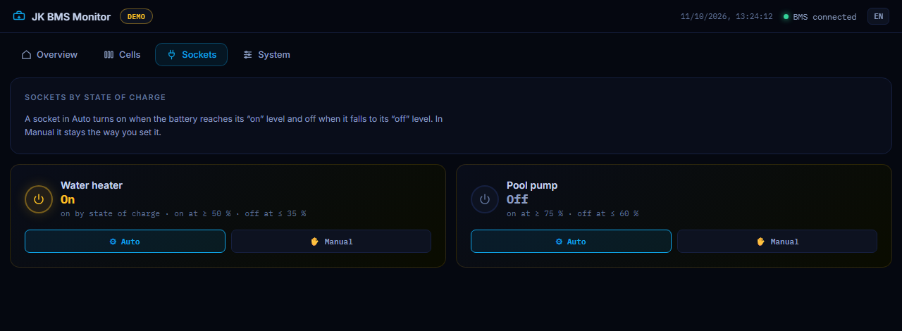

# JK BMS Monitor

A small web dashboard for a **JK BMS** read over **Bluetooth LE** – built for a
Raspberry Pi sitting next to the battery, usable from any phone or computer on
the home network.



- Reads the battery directly over Bluetooth. No cable, no cloud, no vendor app.
- Live dashboard: state of charge, power, voltage, current, every cell, temperatures,
  balancer, cycle count, the protection settings stored in the BMS.
- 24-hour chart of state of charge and power with smooth zoom (wheel, drag, pinch).
- English and Czech, switchable in the header.
- **Read-only.** It never writes a setting to the BMS.
- Optional: [switch TP-Link Tapo smart plugs](#optional-switch-smart-plugs-by-state-of-charge) by the state of charge.
- The protocol code is a separate module without any I/O, so you can reuse just
  the decoder. The byte layout is written down in [docs/PROTOCOL.md](docs/PROTOCOL.md).

| Cells | System |
|---|---|
|  |  |

## Will it work with my BMS?

Developed and tested on one unit: **JK-B2A20S20P, hardware 19H, firmware 19.10**,
8 LiFePO4 cells. Other JK models that speak the same protocol (the "JK02" frames
with the 32-cell layout) should work; older units with the 24-cell layout will
not. If yours shows wrong numbers, `tools/dump_frames.py` makes a capture that is
exactly what is needed to fix it – see [Reporting a problem](#reporting-a-problem).

## Try it without a battery

```bash
git clone https://github.com/TeckOfficial/jk-bms-monitor.git
cd jk-bms-monitor
python3 -m venv venv && venv/bin/pip install -r requirements.txt
venv/bin/python monitor.py --demo
```

Open `http://localhost:8000`. The demo simulates a battery on a small solar
system, sends it through the same frame decoder as a real BMS, and adds two
pretend smart plugs so the Sockets tab can be tried too.

## Install on a Raspberry Pi

Tested on a Raspberry Pi Zero 2 W with Raspberry Pi OS / Debian 13 (Python 3.13,
BlueZ 5.82). Any Linux machine with Bluetooth LE should do.

```bash
sudo apt install python3-venv bluetooth bluez
git clone https://github.com/TeckOfficial/jk-bms-monitor.git
cd jk-bms-monitor
python3 -m venv venv
venv/bin/pip install -r requirements.txt
```

Find the Bluetooth address of the BMS. Close the vendor app on your phone
first: the BMS talks to one device at a time and is not listed while something
is connected to it.

```bash
venv/bin/python monitor.py --scan
```

```
  C8:47:80:xx:xx:xx   -53 dBm  JK-B2A20S20P  <- looks like a JK BMS
  5A:11:xx:xx:xx:xx   -81 dBm  (no name)
```

The name is the one set in the vendor app, so it may also be a serial-like
string without "JK" in it. If nothing is marked, it is usually the strongest
signal when the Pi sits next to the battery.

Run it:

```bash
venv/bin/python monitor.py --address C8:47:80:xx:xx:xx
```

The dashboard is at `http://<address of the Pi>:8000`. The first numbers appear
about 15 seconds after start.

Instead of `--address` you can copy `config.example.json` to `config.json` and
put the address there.

### Start it at boot

```bash
sudo cp jk-bms-monitor.service /etc/systemd/system/
sudo nano /etc/systemd/system/jk-bms-monitor.service     # set the user and the path
sudo systemctl enable --now jk-bms-monitor
journalctl -u jk-bms-monitor -f                            # watch the log
```

The example unit gives the service access to Bluetooth through
`SupplementaryGroups=bluetooth`. If running it by hand fails with a permission
error, add yourself to that group (`sudo usermod -aG bluetooth $USER`) and log
in again.

## Options

| Option | Meaning |
|---|---|
| `--address`, `-a` | Bluetooth address of the BMS. Also `JKBMS_ADDRESS` or `"address"` in `config.json`. |
| `--port` | HTTP port, default 8000 |
| `--host` | interface to listen on, default `0.0.0.0` (all) |
| `--history-file` | where the 24-hour chart is kept, default `history.json` next to the program |
| `--config`, `-c` | another config file |
| `--demo` | simulated battery, no Bluetooth |
| `--scan` | list nearby Bluetooth LE devices and exit |

## Good to know

- **One connection only.** While the monitor runs, the vendor app cannot
  connect to the BMS. Stop the service when you need the app
  (`sudo systemctl stop jk-bms-monitor`).
- **No login.** Anyone who can reach the port can see the dashboard. Keep it on
  your home network; for access from outside use a VPN (WireGuard, Tailscale),
  not a forwarded port.
- **SD card friendly.** The chart history is written to disk once every five
  minutes and on exit, not with every sample.
- **Reconnects by itself** when the BMS goes out of range or stops sending.
- Current and power are **positive while charging**, negative while discharging.

## Optional: switch smart plugs by state of charge

Turn a water heater, a pump or a dehumidifier on only when the battery is
nearly full, and off again before it gets low. Works with **TP-Link Tapo**
plugs (P100, P110 and similar) over the local network.



The feature is off until you add a `sockets` section to `config.json`
(a complete example is in `config.sockets.example.json`):

```bash
venv/bin/pip install tapo
```

```json
{
  "address": "C8:47:80:XX:XX:XX",
  "sockets": {
    "tapo_email": "you@example.com",
    "tapo_password": "your TP-Link account password",
    "on_soc": 95,
    "off_soc": 90,
    "devices": [
      {"name": "Water heater", "ip": "192.168.1.50"},
      {"name": "Pool pump", "ip": "192.168.1.51", "on_soc": 80, "off_soc": 60}
    ]
  }
}
```

| Setting | Meaning |
|---|---|
| `tapo_email`, `tapo_password` | your TP-Link account. The plugs ask for it even for local control. Also `TAPO_EMAIL` / `TAPO_PASSWORD`. |
| `on_soc`, `off_soc` | a socket turns on at or above `on_soc` percent and off at or below `off_soc`; in between it keeps its state. Can be set per socket. |
| `check_interval` | seconds between checks, default 30 |
| `bms_stale_min` | minutes without BMS data after which automatic sockets are turned off, default 10; 0 disables this |
| `devices` | the plugs: a name for the dashboard and the IP address (give them fixed addresses in your router) |

How it behaves:

- A **Sockets** tab appears in the dashboard. Each socket is in **Auto** (follows
  the rule) or **Manual** (stays as you set it; the automation leaves it alone).
  After a restart every socket starts in Auto.
- Nothing is switched before fresh data has arrived from the BMS. If the BMS
  goes silent, automatic sockets are turned off and stay off until data returns.
- An unreachable plug is retried in the background with growing pauses and does
  not hold up the others.
- The state is read back from the plug on every check, so a plug switched by
  its button or in the Tapo app shows correctly.
- `config.json` holds your TP-Link password: keep the file readable only by the
  user running the service (`chmod 600 config.json`). It is in `.gitignore`.
- With sockets enabled the dashboard can switch things, and it still has no
  login. One more reason to keep the port inside your home network.

**Status of this feature:** the rules are covered by tests against simulated
plugs, and the same rule with the same Tapo calls has been switching real plugs
in the author's own installation. This cleaned-up module itself has not yet been
run against a real plug, so watch it the first day.

## API

Everything the page shows is available as JSON.

| | |
|---|---|
| `GET /api/status` | current state: `connected`, `summary`, `cells`, `resistances`, `settings`, `device`, `peaks`, `checksum_errors`, `sockets` |
| `GET /api/history` | chart points of the last 24 hours, one per minute |
| `GET /api/history?since=2026-10-11T12:00:00` | only points newer than the given time |
| `WS /ws` | once a second, the top-level keys of the status that changed |
| `POST /api/sockets/<id>/on`, `/off` | switch a socket by hand (puts it into manual mode); ids are `s1`, `s2`, … |
| `POST /api/sockets/<id>/mode` | body `{"mode": "auto"}` or `{"mode": "manual"}` |

```json
{
  "connected": true,
  "summary": {"total_voltage": 26.511, "current": 4.68, "power": 124.072, "soc": 39,
              "temp1": 12.1, "temp2": 11.5, "mos_temp": 13.4, "delta_mv": 6,
              "remain_ah": 139.76, "nominal_ah": 360.0, "cycles": 29, "...": "..."},
  "cells": [3.315, 3.312, 3.312, 3.312, 3.312, 3.312, 3.315, 3.312]
}
```

## Using only the decoder

```python
from jkbms import protocol

assembler = protocol.FrameAssembler()

def on_notification(data: bytes):              # call this from your own BLE code
    for frame in assembler.feed(data):
        kind, values = protocol.decode(frame)  # "cell_data" | "settings" | "device_info"
        if kind == "cell_data":
            print(values["summary"]["soc"], values["cells"])
```

Or with the bundled bleak client, which handles connecting, the start sequence
and reconnecting:

```python
import asyncio
from jkbms.client import JkBmsClient

async def main():
    client = JkBmsClient("C8:47:80:xx:xx:xx", lambda kind, values: print(kind, values))
    await client.run(asyncio.Event())

asyncio.run(main())
```

## Files

```
monitor.py            the web server: state, history, API, WebSocket
jkbms/protocol.py     frame assembly and decoding (pure Python, no I/O)
jkbms/client.py       Bluetooth connection with reconnect (bleak)
jkbms/sockets.py      optional: Tapo smart plugs switched by state of charge
jkbms/demo.py         simulated battery and plugs; frame encoders used by the tests
web/                  the dashboard (plain HTML, CSS and JavaScript, no build step)
tools/dump_frames.py  capture raw frames for debugging
tests/                unit tests, including frames captured from a real BMS
docs/PROTOCOL.md      the byte layout
```

Run the tests with `python -m unittest discover -s tests` – they need neither
Bluetooth nor any package.

## Reporting a problem

If a value is wrong or missing, a capture helps more than anything:

```bash
sudo systemctl stop jk-bms-monitor
venv/bin/python tools/dump_frames.py --address C8:47:80:xx:xx:xx --out frames.txt
sudo systemctl start jk-bms-monitor
```

Attach `frames.txt` together with your BMS model, hardware and firmware version
and what the vendor app showed at that moment. By default the capture leaves
out the device info frames, **which contain your serial number and the
Bluetooth passcodes in clear text** – do not add them unless asked, and never
in public.

## Credits

The protocol was first documented by the community, most thoroughly in
[syssi/esphome-jk-bms](https://github.com/syssi/esphome-jk-bms). This project is
not affiliated with JiKong / JK BMS.

## License

MIT, see [LICENSE](LICENSE).

---

### Česky

Malý webový přehled pro JK BMS čtený přes Bluetooth, určený pro Raspberry Pi
vedle baterie. Ukazuje nabití, výkon, napětí, proud, všechny články, teploty
a nastavení ochran; má graf za 24 hodin s plynulým přibližováním. Z BMS jen čte,
nic do něj nezapisuje. Volitelně umí podle nabití baterie spínat chytré zásuvky
TP-Link Tapo. Stránka se přepne do češtiny sama podle jazyka
prohlížeče, nebo tlačítkem v záhlaví. Bez baterie jde vyzkoušet příkazem
`python monitor.py --demo`.
